# MatchLab Database

Репозиторий содержит актуальную модель данных проекта MatchLab. Email обязателен при регистрации и служит единственным идентификатором входа. В `user_account` хранится уникальный нормализованный email; `user_email` фиксирует его подтверждение, а независимая `registration_request` хранит email, хеш пароля и хеш одноразового токена до создания аккаунта. Регистрация сразу отправляет письмо; повтор заменяет пароль и токен заявки. Аккаунт создаётся только при подтверждении актуальной ссылки, поэтому чужая незавершённая заявка не занимает email. Существующие аккаунты регистрация не меняет. Письма отправляются синхронно и не сохраняются в модели данных.

## ER-диаграмма

```mermaid
erDiagram
  public_chat_conversation }o--|| users_user_account : chat_conversation_creator
  public_chat_conversation |o--o| public_project_join_request : chat_conversation_join_request
  public_chat_participant }o--|| public_chat_conversation : chat_participant_conversation
  public_chat_participant }o--|| users_user_account : chat_participant_user
  support_support_ticket_attachment }o--|| support_support_ticket : support_ticket_attachment_ticket
  public_message }o--|| public_chat_conversation : message_conversation
  users_user_account }o--o| users_user_account : user_account_status_changed_by
  users_user_email |o--|| users_user_account : user_email_account
  public_project_tag }o--|| public_project : project_tag_project
  public_project_position_skill }o--|| public_project_position : project_position_skill_position
  public_project }o--|| users_user_account : project_owner
  public_project }o--o| users_user_account : project_moderator
  public_project_position }o--|| public_project : project_position_project
  public_project_member }o--|| public_project : project_member_project
  public_project_member }o--|| users_user_account : project_member_user
  public_project_member }o--o| public_project_position : project_member_position
  public_project_join_request }o--|| public_project_position : project_join_request_position
  public_project_join_request }o--|| users_user_account : project_join_request_candidate
  public_project_join_request }o--|| users_user_account : project_join_request_initiator
  public_project_join_request }o--o| users_user_account : project_join_request_responder
  public_message }o--|| users_user_account : message_sender
  public_notification }o--|| users_user_account : notification_user
  media_multipart_upload |o--|| media_file : file_id
  users_user_profile |o--|| users_user_account : user_id
  users_achievement }o--|| users_user_account : user_id
  users_achievement_decision }o--|| users_achievement : achievement_id
  users_achievement_decision }o--|| users_user_account : reviewer_user_id
  users_user_block }o--|| users_user_account : blocker_user_id
  users_user_block }o--|| users_user_account : blocked_user_id
  users_project_context }o--|| users_user_account : initiator_user_id
  users_project_context_member }o--|| users_project_context : project_id
  users_project_context_member }o--|| users_user_account : user_id
  users_profile_review }o--|| users_project_context : project_id
  users_profile_review }o--|| users_user_account : author_user_id
  users_profile_review }o--|| users_user_account : target_user_id
  users_profile_review }o--|| users_project_context_member : project_id_author_user_id
  users_profile_review }o--|| users_project_context_member : project_id_target_user_id
  public_project {
    uuid id PK
    uuid owner_user_id FK
    varchar(255) title
    text summary
    project_type type
    varchar(120) field
    jsonb data
    project_status status
    date planned_start_date
    date planned_end_date
    timestamptz started_at
    timestamptz completed_at
    timestamptz published_at
    uuid moderated_by_user_id FK
    timestamptz moderated_at
    text moderation_comment
    timestamptz created_at
    timestamptz updated_at
  }
  public_project_position {
    uuid id PK
    uuid project_id FK
    varchar(255) title
    text description
    integer slots_count
    boolean is_open
    jsonb data
    timestamptz created_at
    timestamptz updated_at
  }
  public_project_tag {
    uuid project_id PK, FK
    varchar(100) tag PK
  }
  public_project_position_skill {
    uuid project_position_id PK, FK
    varchar(100) skill PK
  }
  public_project_member {
    uuid id PK
    uuid project_id FK
    uuid user_id FK
    uuid project_position_id FK
    project_member_status status
    timestamptz joined_at
    timestamptz left_at
  }
  public_project_join_request {
    uuid id PK
    uuid project_position_id FK
    uuid candidate_user_id FK
    join_request_type type
    join_request_status status
    uuid initiated_by_user_id FK
    text message
    uuid responded_by_user_id FK
    timestamptz responded_at
    timestamptz created_at
    timestamptz updated_at
  }
  public_chat_conversation {
    uuid id PK
    uuid created_by_user_id FK
    uuid join_request_id FK, UK
    timestamptz created_at
    timestamptz updated_at
  }
  public_chat_participant {
    uuid conversation_id PK, FK
    uuid user_id PK, FK
    timestamptz joined_at
    timestamptz last_read_at
    timestamptz archived_at
  }
  public_message {
    uuid id PK
    uuid conversation_id FK
    uuid sender_user_id FK
    text body
    jsonb attachments
    timestamptz created_at
    timestamptz edited_at
    timestamptz deleted_at
  }
  public_notification {
    uuid id PK
    uuid user_id FK
    varchar(100) type
    jsonb data
    timestamptz created_at
    timestamptz read_at
  }
  support_support_ticket {
    uuid id PK
    uuid author_user_id
    uuid assigned_user_id
    support_ticket_status status
    varchar(255) subject
    text description
    uuid target_user_id
    uuid target_project_id
    timestamptz created_at
    timestamptz updated_at
    timestamptz resolved_at
  }
  support_support_ticket_attachment {
    uuid id PK
    uuid support_ticket_id FK
    uuid file_id
  }
  media_file {
    uuid id PK
    uuid owner_user_id
    boolean is_public
    varchar(63) bucket_name
    text object_key
    varchar(255) original_name
    varchar(255) content_type
    bigint size_bytes
    bigint expected_size_bytes
    text etag
    char(64) checksum_sha256
    file_status status
    timestamptz created_at
    timestamptz updated_at
    timestamptz uploaded_at
    timestamptz deleted_at
  }
  media_multipart_upload {
    uuid file_id PK, FK
    text s3_upload_id
    bigint expected_size_bytes
    bigint part_size_bytes
    text status
    jsonb completion_manifest
    timestamptz created_at
    timestamptz updated_at
    timestamptz expires_at
  }
  users_user_account {
    uuid id PK
    varchar(320) email UK
    varchar(255) password_hash
    system_role_code role
    user_account_status status
    uuid status_changed_by_user_id FK
    timestamptz status_changed_at
    text status_comment
    timestamptz last_login_at
    timestamptz created_at
    timestamptz updated_at
  }
  users_user_email {
    uuid user_id PK, FK
    varchar(320) email FK, UK
    timestamptz verified_at
  }
  users_registration_request {
    varchar(320) email PK
    varchar(255) password_hash
    char(64) token_hash UK
    timestamptz expires_at
    timestamptz created_at
  }
  users_trusted_email_domain {
    uuid id PK
    varchar(255) domain UK
    varchar(255) organization_name
    boolean is_active
    timestamptz created_at
    timestamptz updated_at
  }
  users_user_profile {
    uuid user_id PK, FK
    jsonb data
    boolean show_contacts
    boolean show_participating_projects
    timestamptz updated_at
  }
  users_achievement {
    uuid id PK
    uuid user_id FK
    text kind
    jsonb data
    uuid evidence_file_id
    text status
    integer revision
    text moderation_comment
    timestamptz submitted_at
    timestamptz deleted_at
    timestamptz created_at
    timestamptz updated_at
  }
  users_achievement_decision {
    uuid id PK
    uuid achievement_id FK
    integer revision
    uuid reviewer_user_id FK
    boolean approved
    jsonb reviewed_data
    uuid evidence_file_id
    text comment
    timestamptz created_at
  }
  users_user_block {
    uuid blocker_user_id PK, FK
    uuid blocked_user_id PK, FK
    timestamptz created_at
  }
  users_project_context {
    uuid project_id PK
    varchar(255) title
    uuid initiator_user_id FK
    timestamptz completed_at
  }
  users_project_context_member {
    uuid project_id PK, FK
    uuid user_id PK, FK
  }
  users_profile_review {
    uuid id PK
    uuid project_id FK
    uuid author_user_id FK
    uuid target_user_id FK
    varchar(255) title
    text text
    integer rating
    timestamptz created_at
  }
```

Диаграмма генерируется из DBML командой `npm run generate`. Имена сущностей имеют префикс схемы: `users_user_profile` — это `users.user_profile`, `public_project` — `public.project`, `media_file` — `media.file`, `support_support_ticket` — `support.support_ticket`. Составные ключи и связи описаны точно в DBML; значок UK у атрибута означает уникальность одного поля, а не участие в составном уникальном индексе.

Для Media уникальна пара `(bucket_name, object_key)`, а не ключ отдельно. `owner_user_id` не имеет FK на User: идентификатор передаётся через проверенный сеанс Gateway. В Support поля пользователей, проекта и файла также являются межсервисными идентификаторами без FK; внешний ключ есть только от вложения к тикету.

## Содержимое

- `schema/matchlab.dbml` — основной источник истины
- `DATA_MODEL.md` — понятное описание сущностей, связей, ограничений и JSONB

## Принцип работы

Схема поддерживается только в DBML.

Алгоритм внесения изменений:

1. Установить зависимости: `npm ci --ignore-scripts`.
2. Обновить `schema/matchlab.dbml` и `DATA_MODEL.md`.
3. Выполнить `npm run generate` для обновления диаграммы README.
4. Выполнить `npm run check`: проверяются DBML, экспорт PostgreSQL, синхронизация README и парсинг Mermaid.
5. Запушить изменения в отдельную ветку и создать PR. Перед слиянием убедиться, что CI `Validate database schema / schema` прошёл для последнего коммита.

Mermaid-блок не редактируется вручную. Зависимости и их версии закреплены в package-lock.json.

Профили KAN-38 соответствуют миграции 00005 backend: достижения, аудит, блокировки, приватность, контексты проектов и отзывы. Подробнее — [DATA_MODEL.md](DATA_MODEL.md).
